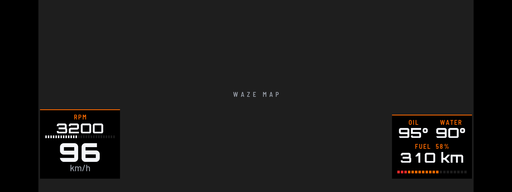
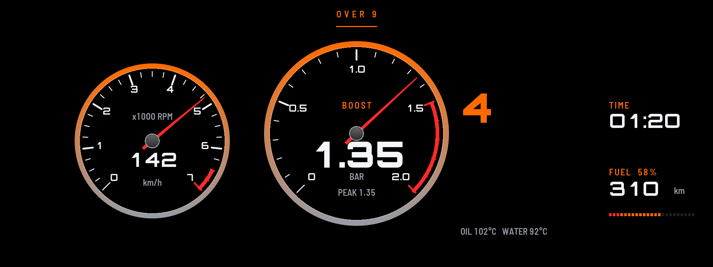

# Cluster Themes

Redraws the whole instrument cluster in a theme of your choice. Open **Cluster Themes** from the apps menu on the center screen: its own page has the themes with pictures, the readouts, the badge, the Waze map, warnings and settings.

## Themes

### GT3

A race dash.

- **Top:** 18 round shift lights (green, yellow, red, then blue) and a segmented rev bar. The lights come on from 3000 rpm and fill up to your shift point.
- **Left:** speed, rpm, and your last shift with its grade.
- **Middle:** the gear, with water and oil temperatures.
- **Right:** boost, your shift point, and the clock.
- **At the shift point** the lights, the rev bar, the rpm and the gear all go red.

### M

A current M8's cluster, traced off a photo of it and drawn on black.

- **Middle:** two bowed glass rev blades either side of the gear and speed, reading 0 to 7000 rpm like the M40i's own cluster. A red marker rides each blade at the rpm, the blade glows below it, and orange and red marks sit before and past your redline. The gear shows with its shifter programme: P, D3, S3 or M3.
- **Left:** a black card with a grey rim, filling the panel from top to bottom, with the tyre block: pressure and temperature at each corner round a car glyph (from the car's tyre monitor, read every 10 seconds, in the car's own units). The fuel dial sits over the card's lower corner, drawn like the M8's: a thin glass bracket inside a hatched chrome bezel, lit from the bottom up to the level, with a red streak at the level and another at the reserve.
- **Right:** what the engine, chassis, steering and gearbox are set to, as rows with a step bar (two above BMW's black gear box and two below it, since the car paints over that spot), and the oil temperature dial, the same glass bracket (blue streak at the cold end, red at the hot end). The rows follow the drive mode buttons: Eco Pro, Comfort, Sport, Sport Plus and Sport Individual. The car only reports that an Individual setup is on, not what each part is set to, so those rows read INDIVIDUAL.
- **Bottom:** range, the clock, and the outside temperature.

### Sport

The look of BMW's newer Live Cockpit Sport view.

- **Left:** speed as a blue bracket on BMW's 0 to 200 mph scale (0 to 320 km/h), with the digital speed and a fuel bar inside it.
- **Right:** revs as a red bracket on the M40i's 0 to 7000 rpm scale, with yellow and red marks around your redline, with the gear and an oil temperature bar inside it.
- **Middle:** black, or the Waze map with "Show Waze map inside the theme" on.
- **Bottom:** boost and coolant in the blue and red strip, plus the clock, range and outside temperature.

### Minimal

Just the speed, big, with the gear beside it and a thin fuel line under it (the reserve end is red). Nothing else.

### Roadster

Two classic round dials with chrome rings and an orange needle: speed on the left (0 to 160 mph, or 0 to 240 km/h), revs on the right (0 to 7000 rpm, a red band before the redline, and the ring turns red at your shift point). The speed also shows in figures inside its dial, and the gear sits between the dials in chrome. Six readouts left and right: oil, coolant and range, then boost, the clock and the outside temperature, each one changeable on the Readouts tab.

### Track

A race dash for track days: a shift bar across the top, a big gear with the speed under it, all four tyres (pressure and temperature, from the car's tyre monitor) on the left, and oil, coolant and boost on the right (changeable).

### Drag

A full-width shift bar and a 0 to 60 mph timer (0 to 100 km/h in metric). Stop for half a second and it reads READY; the clock starts the moment the car moves and stops at 60. Your best time is kept. Also the speed, the gear, the peak boost of the run, and one readout you pick. The timer runs off the car's speed signal, which reads a little under BMW's speedometer, so treat it as a good guide rather than a timing gear.

### Rally

A segmented rev arc sweeps across the top of the screen, white, then rally yellow from the shift zone, red and flashing at the redline. A huge gear sits in the middle with the speed under it. On the left a G-meter: a dot shows the cornering and braking or accelerating force (it moves into the turn and up when you speed up), white, then amber from 0.5 g, then red from 0.8 g, with a fading trail behind it and an outline of the most g you reached this drive in every direction. Under it the g now (left or right, accelerating or braking), the best of the drive and the range. Boost with a peak-hold bar and two readouts on the right.

### Retro 80s

An 80s digital dash: amber seven-segment digits with their unlit 8s showing faintly behind, for the gear, the speed and the clock. A segmented rev bar runs across the top, bar graphs show oil, water and fuel on the left, and boost and two readouts sit on the right.

### OVER 9 Map

The Waze map over the whole cluster, with two small boxes on it: rpm and speed bottom-left, oil and water temperatures and fuel (percent, km left) bottom-right. Turn on "Show Waze map inside the theme".

By default waze-on-cluster draws the map only in the 1088x480 middle. For the whole screen, add one line to `/var/opt/waze-on-cluster/waze-on-cluster.local.conf` on the car and restart it (`systemctl restart waze-on-cluster`):

    map_rect = 144,0,1632,720     # full height, the map's own shape (thin black bars at the sides)
    map_rect = 0,0,1920,720       # the whole screen, the map stretched about 17 % wider

### OVER 9 Boost

A big boost gauge in the middle (0-2 bar, needle, the digital boost and the peak), a rev dial on the left with the speed inside, the gear, the clock, fuel with the km left, and oil and water temperatures.

### Cruise

Calm and quiet for the highway: the speed in soft white, the gear beside it, and one row of trip figures (range, fuel, outside temperature, your average speed this drive and the time). No rev bar, and nothing red until the fuel runs low. The average speed counts only time moving and shows after the first minute of the drive.

### Dyno

A safety dash for hard pulls, in BMW M colours: twelve tiles in a grid (rpm, speed, boost, oil, coolant, intake air, cornering g, braking or accelerating g, the gear, fuel, range and outside temperature) and tall Power and Torque tiles on the right, each with a bar that runs light blue, dark blue, then red. A tile turns solid red while its oil, coolant or boost reading is over your warning limit. A rev bar runs across the top. Every tile but the gear can show another sensor (Readouts tab). The gap between Power and Torque is where BMW draws its black gear box, so nothing is hidden under it.

Minimal, Roadster, Track, Drag, Rally, Retro 80s, Cruise and Dyno have no map window yet; with "Show Waze map inside the theme" on, Waze stays in its usual place while they show.

More themes are on the way.

## Off and drive modes

- **Off (BMW's own cluster):** pick it as the theme and the app draws nothing, so BMW's cluster comes back.
- **Change with SPORT / COMFORT / ECO PRO** (on by default): the cluster follows the drive mode buttons, with a theme for each mode. Out of the box, Sport shows GT3, and Comfort and Eco Pro show BMW's own cluster. Until the car reports a mode, the plain theme setting is used.
- **With HUD Widgets:** the cluster theme and the HUD cannot show at the same time, because cluster-render has one screen slot for both. With the defaults, Sport gets the cluster theme and Comfort gets the HUD, so they take turns. Pick a theme while the HUD is on and the page asks whether to turn HUD Widgets off; yes turns it off until you pick a layout in HUD Widgets again, and it asks the same the other way round.

## Settings

- **Theme**, and one per drive mode.
- **Readouts:** pick which car sensor each GT3, Roadster, Track, Drag, Rally, Retro 80s or Dyno readout shows (speed, rpm, boost, temperatures, tyres, fuel, g, power and more).
- **Show Waze map inside the theme:** GT3, Sport and M open a window in the middle and Waze on Cluster draws its map in it, above BMW's own map view, so nothing shows twice. When the map goes away the theme fills back in. While it is on, Waze's map on the HUD is off. Needs robertnisipeanu's Waze on Cluster; turning it off gives Waze its usual place back.
- **Badge:** the model name, like "BMW X3 M40i", as text in the theme's font (GT3 top left, Sport and M bottom centre). Off by default.
- **Warnings:** oil, coolant and boost limits. A readout over its limit flashes red (oil 130°C and coolant 115°C by default, boost off).
- **Test the shift lights:** runs the rpm up to the shift point for about 4 seconds while the car stands.
- **Night colours:** after sunset the theme's whites and greys dim to 60% (Auto, the default), or Off.
- **Units:** mph, °F, psi or km/h, °C, bar.
- **Clock:** 12-hour or 24-hour.
- **Redline:** where the red marks start on the rev scales (they always cover at least the last 500 rpm, and the yellow marks sit in the 700 rpm before them).
- **Shift point before redline:** how far below the redline the shift lights peak (300 rpm by default).
- **Cold-engine rev guard:** until the oil reaches 80°C, the shift point starts at 4500 rpm and climbs as the oil warms up.
- **Show boost.**
- **G-meter** (its own tab): the range (0.8, 1.0, 1.2, 1.5 or 2.0 g at the edge; 1.2 by default), the trail (off, 1, 2 or 4 seconds), **Swap left / right** (if the dot goes the wrong way in a turn) and **Brake on top**, the best left, right, accelerating, braking and overall g of the drive with a Reset button, and a live copy of the meter. The g comes from the car's own acceleration sensor: parked on level ground it reads 0.00, and a hill adds a little.
- **Demo data:** fake driving data for trying it out parked.
- **Calibration grid:** a theme that draws lines every 50 px with labels, for checking on a photo where things land on the real screen. It also carries a few test marks used to measure cluster-render's limits on the car.
- **Map calibration:** a theme that leaves BMW's whole map window open with a grid through it, for photographing exactly what shows through the map cut-out with a navigation map up.

**Shift grades:** every upshift is graded on its peak rpm. EARLY means more than 250 rpm under the shift point, LATE more than 200 over it, COLD REV the same while the cold guard is on, LIMITER within 60 rpm of the redline, and anything in between is SPOT ON.

## Requirements

[cluster-render](https://github.com/robertnisipeanu/idrive-apps), installed from the `robertnisipeanu/idrive-apps` Store source.

## On the car

Tested on a 2020 X3 M40i. GT3 draws complete. The car draws at most 8 layers per connection, and every theme fits in that. Still to be checked:

- whether M and Sport draw complete (if not, the first row of the app's page says how many parts are drawn and why the rest are not);
- whether BMW's warning lights still show over the dash (start the car with a seat belt off and look);
- the drive mode switching and the map window's position;
- how the colours and edges look on the real screen.

Version history is in the repo's [CHANGELOG.md](../../CHANGELOG.md).
